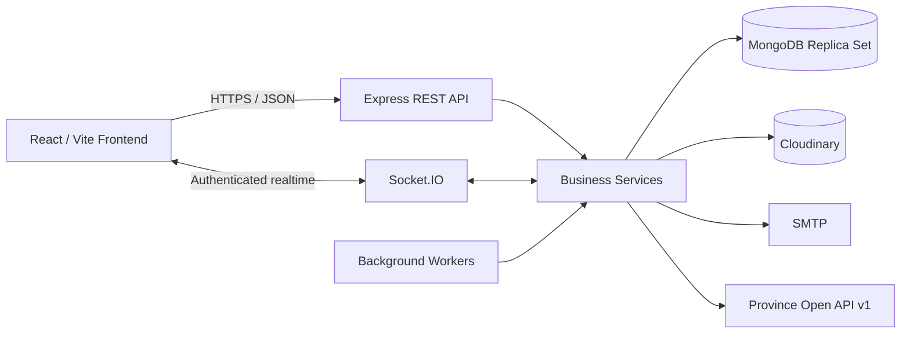

<div align="center">

# JOBHUB

### Nền tảng tuyển dụng full-stack cho ứng viên và doanh nghiệp

Backend nghiệp vụ bằng Express/MongoDB, frontend bằng React/Vite và phân phối realtime qua Socket.IO.

`React 19` · `Vite 8` · `Express 5` · `MongoDB` · `Socket.IO` · `Tailwind CSS 4`

[Backend](backend/README.md) · [Frontend](frontend/README.md) · [AI Kit](ai-kit/README.md) · [Backend Product Roadmap](docs/product/backend/roadmap.md) · [AI Kit Roadmap](docs/product/ai-kit/roadmap.md) · [Project Status](docs/project-status/index.md) · [Architecture](docs/engineering/architecture.md)

</div>

---

JOBHUB hỗ trợ toàn bộ chuỗi tuyển dụng từ quản lý tài khoản và Company, đăng Job, tìm kiếm việc/CV, ứng tuyển, phân công Application, pipeline, chat, lịch phỏng vấn, thông báo đến Job Invitation.

Repository hiện có độ trưởng thành không đồng đều giữa hai ứng dụng: backend đã triển khai phần lớn phạm vi V1–V15, trong khi frontend mới hoàn tất nền tảng kỹ thuật và authentication lifecycle V1; UI nghiệp vụ vẫn chưa được xây dựng.

> [!IMPORTANT]
> README này là cổng vào kỹ thuật của repository. Backend và các Frontend surface dùng [Backend Product Specifications](docs/product/backend/versions/) cùng [Backend Data Contracts](docs/data/backend/versions/); AI Kit dùng [AI Kit roadmap](docs/product/ai-kit/roadmap.md), [Product Specifications](docs/product/ai-kit/versions/) và [Data Contracts](docs/data/ai-kit/versions/). [Engineering docs](docs/engineering/) quyết định kiến trúc/owner, còn [Project Status](docs/project-status/index.md) ghi nhận trạng thái triển khai cùng bằng chứng xác minh.

## Mục lục

- [Tổng quan](#tổng-quan)
- [Trạng thái sản phẩm](#trạng-thái-sản-phẩm)
- [Chức năng chính](#chức-năng-chính)
- [Kiến trúc hệ thống](#kiến-trúc-hệ-thống)
- [Công nghệ](#công-nghệ)
- [Cấu trúc repository](#cấu-trúc-repository)
- [Yêu cầu hệ thống](#yêu-cầu-hệ-thống)
- [Quick start](#quick-start)
- [Cấu hình môi trường](#cấu-hình-môi-trường)
- [Các lệnh thường dùng](#các-lệnh-thường-dùng)
- [API và realtime](#api-và-realtime)
- [Kiểm thử và xác minh](#kiểm-thử-và-xác-minh)
- [Quy tắc phát triển](#quy-tắc-phát-triển)
- [Triển khai production](#triển-khai-production)
- [Tài liệu nguồn chuẩn](#tài-liệu-nguồn-chuẩn)
- [Giấy phép](#giấy-phép)

## Tổng quan

| Ứng dụng | Vai trò | Trạng thái hiện tại | Tài liệu |
| --- | --- | --- | --- |
| Backend | REST API, nghiệp vụ, persistence, worker và realtime server | Phần lớn V1–V15 đã triển khai; V8 còn `IN PROGRESS` | [Backend README](backend/README.md) |
| Frontend | Browser UI, routing, auth client, HTTP/realtime client | Foundation và authentication lifecycle V1 đã xác minh; chưa có UI nghiệp vụ | [Frontend README](frontend/README.md) |
| Backend Product/Data docs | Yêu cầu nghiệp vụ và hợp đồng persistence | V1–V15 có tài liệu phiên bản; V16–V17 mới ở roadmap | [Docs](docs/product/backend/) |
| AI Kit | Private local Node.js package `@jobhub/ai-kit`, chạy trong Backend runtime; không có process/server riêng | Technical foundation sẵn sàng: Gemini và Groq provider adapter, fallback policy nội bộ, trích xuất lớp text PDF bằng PDF.js (không OCR). Chưa có năng lực AI nghiệp vụ (AI #1/#2/#3); AI #1 chưa có Product/Data specification được phê duyệt | [AI Kit README](ai-kit/README.md) · [Status](docs/project-status/ai-kit/foundation.md) |

### Điểm nổi bật

- Business workflows có transaction và concurrency guards trên MongoDB replica set.
- Phân quyền theo Candidate, Recruiter, Company Manager và Platform Admin.
- CV generated/uploaded, snapshot CV khi apply và lưu trữ Cloudinary có kiểm soát.
- Chat, Notification và Conversation state được fan-out realtime sau durable commit.
- Background worker phục hồi Notification và vật chất hóa Job Invitation hết hạn.
- Request tracing xuyên HTTP bằng `X-Request-Id` và structured logging ở production.
- Kiến trúc frontend có canonical owner cho router, Redux, Axios, Socket.IO, validation và theme.
- Cổng verification riêng cho backend, AI Kit và frontend.

## Trạng thái sản phẩm

Theo [Backend Product Roadmap](docs/product/backend/roadmap.md):

| Phiên bản | Phạm vi | Trạng thái |
| --- | --- | --- |
| V1 | Tài khoản và vòng đời xác thực | `COMPLETED AND VERIFIED` |
| V2 | Company onboarding và quản trị cấp nền tảng | `COMPLETED AND VERIFIED` |
| V3 | Quản lý nhân sự tuyển dụng của Company | `COMPLETED AND VERIFIED` |
| V4 | Danh mục chuẩn của nền tảng | `COMPLETED AND VERIFIED` |
| V4.1 | Migration Location sang danh mục hành chính Việt Nam hai cấp | `COMPLETED / ACCEPTED` |
| V4.2 | Structured Salary, Metadata Catalog và Candidate Skill Keyword Search | `COMPLETED / ACCEPTED` |
| V5 | Job và vòng đời phê duyệt Job | `COMPLETED AND VERIFIED` |
| V6 | Recruitment Team và chuyển giao trách nhiệm | `COMPLETED AND VERIFIED` |
| V7 | Candidate Profile và thư viện CV | `COMPLETED AND VERIFIED` |
| V8 | Job Discovery | `IN PROGRESS` |
| V9 | Candidate chủ động Apply và tạo Application | `COMPLETED AND VERIFIED` |
| V10 | Phân công Application và Recruitment Pipeline | `COMPLETED AND VERIFIED` |
| V11 | Conversation và Chat thuộc Application | `COMPLETED AND VERIFIED` |
| V12 | Interview Schedule | `COMPLETED AND VERIFIED` |
| V13 | Notification và phân phối realtime | `COMPLETED AND VERIFIED` |
| V14 | Candidate Search trên CV `PUBLIC` | `COMPLETED AND VERIFIED` |
| V15 | Job Invitation và nhánh Recruiter săn ứng viên | `COMPLETED AND VERIFIED` |
| V16 | Saved Jobs | `PLANNED` |
| V17 | Dashboard, thống kê và giám sát | `PLANNED` |

> [!NOTE]
> Bảng trên là trạng thái sản phẩm cấp repository, không phải mức hoàn thiện UI. Frontend hiện chỉ có status leaf V1; việc backend hoàn thành một phiên bản không đồng nghĩa màn hình frontend của phiên bản đó đã tồn tại.

Ý nghĩa trạng thái:

- `IN PROGRESS`: đã bắt đầu triển khai nhưng toàn bộ phạm vi chưa hoàn tất xác minh.
- `COMPLETED AND VERIFIED`: phạm vi được phê duyệt đã triển khai và vượt qua verification bắt buộc.
- `COMPLETED / ACCEPTED`: đã qua thêm Final Acceptance Review.
- `PLANNED`: chỉ có vị trí trên roadmap, chưa được phép suy diễn yêu cầu chi tiết.

## Chức năng chính

### Tài khoản và tổ chức

- Đăng ký Candidate và Company Manager.
- Xác minh email, đăng nhập, refresh session, đăng xuất và đặt lại mật khẩu.
- Company onboarding, submit/approval/confirmation và khóa Company.
- Quản lý Recruiter: tạo, kích hoạt, khóa, mở khóa, chấm dứt và chuyển giao trách nhiệm.
- Platform Admin quản lý account lifecycle, Company registration và danh mục.

### Job và tuyển dụng

- Job draft, submit, approve, reject, publish, close và expire.
- Recruitment Team với Primary/Supporting Recruiter.
- Location hai cấp, Structured Salary, Category và Experience Level.
- Job Discovery công khai với filter/sort.
- Candidate Search trên CV `PUBLIC`.

### Candidate và CV

- Candidate Profile.
- Generated CV và Uploaded PDF CV.
- Preview/download, visibility, default CV, archive và thay tệp.
- Harvard-style PDF generation với font Unicode đi kèm.

### Application pipeline

- Direct Apply hoặc tạo Application từ Job Invitation.
- Snapshot CV độc lập tại thời điểm nộp.
- Assign, reassign, take over, unassign và automatic unassign.
- Recruitment Pipeline, workspace và workload projection.
- Candidate withdraw và submitted-CV replacement.

### Tương tác và realtime

- Conversation/Message gắn với Application.
- Candidate Availability và Interview Proposal lifecycle.
- Notification bền vững, unread/open state và recovery.
- Socket.IO fan-out cho Notification, Message và Conversation state.
- Job Invitation send/read/reject/accept/revoke/expiration/invalidation.

Danh sách endpoint và boundary chi tiết nằm trong [Backend README](backend/README.md#danh-mục-endpoint).

## Kiến trúc hệ thống



### Backend dependency direction

```text
route -> middleware -> controller -> service -> model/database
                                      |
                                      +-> approved infrastructure client/utility

entry point -> worker -> service -> model/database
service sau durable commit -> sockets facade -> authenticated user room
```

### Frontend dependency direction

```text
main -> providers -> App -> authentication bootstrap -> router
router -> route groups -> guards/layouts/pages
pages -> features + common components + UI primitives
features -> API modules / socket facade / store hooks / validation
```

Nguyên tắc cốt lõi là mỗi trách nhiệm có một canonical owner. Repository không dùng repository layer ở backend và không cho phép router/store/Axios/Socket.IO client song song ở frontend.

## Công nghệ

| Lớp | Công nghệ chính |
| --- | --- |
| Frontend runtime | React 19, React Router 7, Redux Toolkit |
| Frontend tooling | Vite 8, ESLint 10 |
| Styling/UI | Tailwind CSS 4, shadcn/ui conventions, Radix, Lucide, Sonner |
| Form/validation | React Hook Form, Zod |
| HTTP/realtime client | Axios, Socket.IO Client |
| Backend runtime | Node.js ES Modules, Express 5 |
| Persistence | MongoDB, Mongoose 9 |
| Realtime server | Socket.IO 4 |
| File/PDF | Cloudinary, Multer, `file-type`, `pdf-lib`, Fontkit |
| Authentication | JWT, session-bound refresh credential, bcryptjs |
| Email | Nodemailer/SMTP |
| Backend testing | Vitest, Supertest, MongoDB Memory Server |
| AI Kit | Node.js ES Modules, Gemini/Groq adapters, PDF.js, Vitest |

## Cấu trúc repository

```text
JOBHUB/
├── ai-kit/                          # Local package @jobhub/ai-kit; không có process riêng
├── backend/
│   ├── index.js                     # Process entry point
│   ├── scripts/                     # Migration và architecture verification
│   ├── src/
│   │   ├── config/                  # Env, MongoDB, Cloudinary, SMTP
│   │   ├── constants/               # Shared vocabularies/mappings
│   │   ├── controllers/             # HTTP boundary
│   │   ├── database/                # Versioned migrations và seed scaffold
│   │   ├── middlewares/             # Auth, authorization, validation, errors
│   │   ├── models/                  # Mongoose schemas/invariants
│   │   ├── routes/                  # Root và feature routers
│   │   ├── services/                # Business workflows
│   │   ├── sockets/                 # Realtime distribution
│   │   ├── utils/                   # Generic helpers/logger
│   │   └── workers/                 # Recovery/expiration schedulers
│   ├── test/                        # Unit, integration và acceptance tests
│   └── README.md
├── frontend/
│   ├── src/
│   │   ├── apis/                    # Axios client và resource APIs
│   │   ├── components/              # Common và UI primitives
│   │   ├── features/                # Feature-owned client behavior
│   │   ├── layouts/                 # Shared route frames
│   │   ├── pages/                   # URL-mapped screens
│   │   ├── routes/                  # Router, route groups và guards
│   │   ├── socket/                  # Lazy Socket.IO client
│   │   ├── store/                   # Redux composition/hooks
│   │   ├── styles/                  # Tailwind/theme tokens
│   │   ├── utils/                   # Constants/shared helpers
│   │   └── validation/              # Zod/RHF provider và schemas
│   ├── test/                        # Focused authentication tests
│   └── README.md
├── docs/
│   ├── product/                     # Roadmap và version specifications
│   ├── data/                        # Versioned data contracts
│   ├── engineering/                 # Architecture, conventions, owners
│   └── project-status/              # Implementation/verification snapshots
├── .agents/skills/                  # Repository-local agent workflows
├── AGENTS.md                        # Repository agent contract
└── README.md                        # Tài liệu tổng quan này
```

## Yêu cầu hệ thống

- Node.js `>=20.19.0`. Frontend Vite 8 hỗ trợ `^20.19.0` hoặc `>=22.12.0`.
- npm cho backend và `ai-kit` vì `backend/package-lock.json` và `ai-kit/package-lock.json` là lockfile được dùng trong hướng dẫn.
- Yarn Classic 1.x cho frontend vì `frontend/yarn.lock` là lockfile v1.
- MongoDB replica set hoặc MongoDB Atlas; nhiều workflow backend sử dụng multi-document transaction.
- Tài khoản Cloudinary.
- SMTP credential để gửi email.
- Truy cập Province Open API v1 cho Location catalog.
- Trình duyệt hiện đại cho frontend.

## Quick start

### 1. Clone repository

```bash
git clone <repository-url>
cd JOBHUB
```

### 2. Cài đặt và cấu hình backend

Backend phụ thuộc local package `@jobhub/ai-kit` qua `file:../ai-kit`. `npm ci` trong `backend/` chỉ tạo symlink tới thư mục `ai-kit/` cùng cấp, không cài dependency của AI Kit, nên phải cài `ai-kit/` trước:

```bash
cd ai-kit
npm ci
cd ../backend
npm ci
cp .env.example .env
```

`ai-kit/` không có process riêng; chỉ backend được khởi động.

Điền đầy đủ cấu hình trong `backend/.env`. MongoDB local phải chạy ở chế độ replica set, ví dụ URI:

```dotenv
MONGODB_URI=mongodb://127.0.0.1:27017/jobhub?replicaSet=rs0
```

Với database hoàn toàn mới, áp strict Structured Salary guard trước lần startup đầu tiên:

```bash
node scripts/run-migration.js v42-legacy-salary-cutover --preflight
node scripts/run-migration.js v42-legacy-salary-cutover
```

Khởi tạo Experience Level dataset nếu database chưa có:

```bash
node scripts/run-migration.js v4-experience-level-dataset
```

Chạy backend:

```bash
npm run dev
```

Backend mặc định phục vụ REST API và Socket.IO tại `http://localhost:8000`.

> [!WARNING]
> Không chạy các migration lịch sử khác một cách máy móc trên database có dữ liệu. Đọc status/data contract tương ứng, backup và chạy preflight khi được hỗ trợ.

### 3. Cài đặt và chạy frontend

Mở terminal thứ hai từ repository root:

```bash
cd frontend
yarn install --frozen-lockfile
cp .env.example .env
yarn dev
```

Frontend mặc định chạy tại `http://localhost:5173` và cấu hình mẫu gọi backend tại port `8000`.

Đảm bảo `backend/.env` cho phép origin frontend:

```dotenv
CORS_ALLOWED_ORIGINS=http://localhost:5173
```

### 4. Kiểm tra nhanh

| Thành phần | URL |
| --- | --- |
| Frontend | `http://localhost:5173/` |
| Backend API base | `http://localhost:8000/api` |
| Backend smoke endpoint | `http://localhost:8000/api/` |
| Socket.IO | `http://localhost:8000` |

```bash
curl http://localhost:8000/api/
```

Kết quả mẫu:

```json
{
  "success": true,
  "message": "Hello World",
  "timestamp": 1775472000000
}
```

## Cấu hình môi trường

### Backend

`backend/.env.example` bao gồm các nhóm cấu hình:

- Runtime và MongoDB.
- Cloudinary và upload limit.
- JWT, session và bcrypt.
- Platform Admin provisioning inputs.
- SMTP và application URL.
- CORS origins.
- Notification recovery và Job Invitation expiration workers.
- Logging.

Danh sách biến, default và lưu ý vận hành đầy đủ: [Backend README — Biến môi trường](backend/README.md#biến-môi-trường).

### Frontend

```dotenv
VITE_API_BASE_URL=http://localhost:8000/api
VITE_SOCKET_URL=http://localhost:8000
```

Mọi biến `VITE_*` là public và được đóng gói vào browser bundle. Không đặt secret vào frontend environment variables.

Chi tiết: [Frontend README — Biến môi trường](frontend/README.md#biến-môi-trường).

### Bảo vệ secret

- Không commit `backend/.env` hoặc `frontend/.env`.
- Không đưa JWT secret, database URI, SMTP password hoặc Cloudinary secret vào `VITE_*`.
- Dùng secret manager của nền tảng khi triển khai.
- Không ghi credential/token/CV content nhạy cảm vào log hoặc tài liệu.

## Các lệnh thường dùng

### Từ root repository

Root `package.json` chuyển tiếp lệnh tới script hiện có của từng ứng dụng. Không cần cài dependency tại root; vẫn cài dependency riêng theo hướng dẫn Quick start ở trên.

| Lệnh tại root | Mục đích |
| --- | --- |
| `yarn client dev` | Chạy frontend bằng Vite |
| `yarn server dev` | Chạy backend bằng Nodemon |
| `yarn server start` | Chạy backend production entry point |
| `yarn build` | Build frontend |
| `yarn client preview` | Preview frontend bundle |
| `yarn lint` | Lint backend, AI Kit và frontend |
| `yarn test` | Chạy backend tests, AI Kit tests và frontend auth tests |
| `yarn verify:agent` | Chạy lần lượt cổng verification của cả ba thư mục |

Dùng `yarn client <script>`, `yarn server <script>` hoặc `yarn ai-kit <script>` để chạy riêng từng phần, ví dụ `yarn server test:watch`, `yarn client verify:agent`, `yarn ai-kit test`. Các tham số phía sau được chuyển tiếp, ví dụ `yarn client dev --host 0.0.0.0` hoặc `yarn server test --reporter=verbose`.

### Backend

Chạy trong `backend/`:

| Lệnh | Mục đích |
| --- | --- |
| `npm run dev` | Chạy API bằng Nodemon |
| `npm start` | Chạy production entry point |
| `npm run lint` | ESLint |
| `npm run lint:fix` | Tự sửa lỗi lint được hỗ trợ |
| `npm test` | Chạy toàn bộ Vitest suite |
| `npm run test:watch` | Vitest watch mode |
| `npm run verify:architecture` | Kiểm tra ràng buộc kiến trúc |
| `npm run verify:agent` | Lint + architecture + toàn bộ test |

### AI Kit

Chạy trong `ai-kit/`:

| Lệnh | Mục đích |
| --- | --- |
| `npm run lint` | ESLint |
| `npm test` | Chạy offline Vitest suite |
| `npm run test:watch` | Vitest watch mode |
| `npm run verify:agent` | Cổng offline chính thức: lint + toàn bộ test |
| `npm run smoke:gemini` | Live smoke Gemini, chạy tường minh và có thể tiêu thụ quota |
| `npm run smoke:groq` | Live smoke Groq, chạy tường minh và có thể tiêu thụ quota |

### Frontend

Chạy trong `frontend/`:

| Lệnh | Mục đích |
| --- | --- |
| `yarn dev` | Chạy Vite development server |
| `yarn build` | Tạo production bundle |
| `yarn preview` | Preview bundle ở local |
| `yarn lint` | ESLint |
| `yarn test:auth` | Focused authentication tests |
| `yarn verify:agent` | Auth tests + lint + production build |

## API và realtime

### HTTP

- REST API dùng prefix `/api`.
- Protected request dùng `Authorization: Bearer <access-token>`.
- Mỗi response có `X-Request-Id` để liên kết browser log với backend log.
- Lỗi chuẩn hóa theo dạng:

```json
{
  "error": {
    "message": "Mô tả lỗi",
    "details": {}
  }
}
```

Frontend có một Axios client dùng chung, chỉ gắn token cho request khai báo `requiresAuthentication: true`, refresh single-flight khi protected request nhận `401`, và retry tối đa một lần.

### Realtime

Socket.IO dùng cùng backend origin và xác thực bằng access token trong handshake. Các event hiện có:

| Event | Dữ liệu chính |
| --- | --- |
| `notification` | Notification vừa được materialize |
| `message` | Message mới trong Application Conversation |
| `conversationState` | Mode hiện tại của Conversation |

Realtime là best-effort, không đảm bảo exactly-once và không thay thế dữ liệu bền vững. Client phải resync qua HTTP sau reconnect hoặc khi cần trạng thái authoritative.

Xem chi tiết:

- [Backend endpoint catalog](backend/README.md#danh-mục-endpoint)
- [Backend realtime contract](backend/README.md#realtime-với-socketio)
- [Frontend HTTP/auth lifecycle](frontend/README.md#http-client-và-xử-lý-lỗi)
- [Frontend realtime client](frontend/README.md#realtime-với-socketio)

## Kiểm thử và xác minh

Backend, AI Kit và frontend có cổng verification độc lập. Một cổng pass không xác minh area còn lại.

### Backend gate

```bash
cd backend
npm run verify:agent
```

Bao gồm ESLint, deterministic architecture checks và toàn bộ Vitest suite.

### AI Kit gate

```bash
cd ai-kit
npm run verify:agent
```

Bao gồm ESLint và offline Vitest suite. Live provider smoke không thuộc gate này và chỉ chạy khi được yêu cầu tường minh.

### Frontend gate

```bash
cd frontend
yarn verify:agent
```

Bao gồm focused authentication Node tests, ESLint và Vite production build.

### Giới hạn của verification

- Backend gate không tự chứng minh MongoDB Atlas, Cloudinary, SMTP hoặc Province Open API thật đang hoạt động.
- AI Kit gate không gọi provider thật và không chứng minh Gemini/Groq live hoặc fallback composition đang hoạt động.
- Frontend gate chưa có browser/end-to-end harness và không chứng minh rendering, accessibility hoặc backend integration.
- Smoke test production phải được thực hiện riêng và chỉ được báo cáo khi đã chạy thực tế.

## Quy tắc phát triển

- Đọc implementation liên quan và tìm canonical owner trước khi tạo abstraction mới.
- Giữ một source of truth; không tạo client, config, constant, helper hoặc workflow song song.
- Thực hiện thay đổi nhỏ nhất nhưng đầy đủ và tránh refactor ngoài phạm vi.
- Không thêm/xóa production dependency khi chưa được phê duyệt rõ ràng.
- Không suy diễn business behavior từ roadmap title hoặc mã nguồn cũ khi đã có Product Specification.
- Backend giữ dependency direction `route -> middleware -> controller -> service -> model`.
- Frontend giữ một router, Redux store, Axios client, Socket.IO client, Toaster và `VITE_*` reader.
- Route guard và client validation chỉ hỗ trợ UX; backend vẫn là authority cho auth, authorization và business invariant.
- Sau thay đổi material, chạy focused checks và cổng verification của đúng ứng dụng.
- Không tuyên bố test/build/lint pass nếu lệnh tương ứng chưa thực sự chạy thành công.

Agent/contributor workflow đầy đủ nằm trong [AGENTS.md](AGENTS.md), [backend/AGENTS.md](backend/AGENTS.md), [ai-kit/AGENTS.md](ai-kit/AGENTS.md) và [frontend/AGENTS.md](frontend/AGENTS.md).

## Triển khai production

### Backend

- Deployment/build context phải chứa cả `ai-kit/` và `backend/` cùng cấp; chỉ copy riêng `backend/` là không đủ. Cài bằng `npm ci` trong `ai-kit/` rồi trong `backend/`, và chỉ khởi động backend (`npm start` trong `backend/`).
- Đặt `NODE_ENV=production`.
- Hoàn tất migration/cutover bắt buộc trước khi deploy code phụ thuộc vào chúng.
- Chạy sau HTTPS reverse proxy và process/container supervisor hỗ trợ `SIGTERM`.
- Cho phép outbound đến MongoDB, Cloudinary, SMTP và Province Open API v1.
- Thu thập JSON logs và bảo toàn `X-Request-Id` qua proxy.
- Worker chạy trong mỗi process; chúng chịu được nhiều process nhưng không phải distributed exactly-once scheduler.

### Frontend

- Cung cấp đúng `VITE_API_BASE_URL` và `VITE_SOCKET_URL` tại thời điểm build.
- Chạy `yarn build` và phục vụ `frontend/dist/` bằng static hosting/CDN hoặc web server production.
- Cấu hình SPA fallback về `index.html` cho browser routes.
- Không dùng `yarn preview` làm production server.
- Thêm frontend production origin vào backend `CORS_ALLOWED_ORIGINS`.
- Bật HTTPS và hỗ trợ WebSocket/Socket.IO upgrade qua reverse proxy.

Checklist chi tiết nằm trong [Backend README](backend/README.md#triển-khai-production) và [Frontend README](frontend/README.md#build-và-triển-khai-production).

## Tài liệu nguồn chuẩn

| Câu hỏi | Tài liệu |
| --- | --- |
| Backend đang đi đến đâu? | [Backend Product Roadmap](docs/product/backend/roadmap.md) |
| Yêu cầu nghiệp vụ Backend/Frontend cụ thể là gì? | [Backend Product Specifications](docs/product/backend/versions/) |
| Dữ liệu Backend phải được lưu như thế nào? | [Backend Data Contracts](docs/data/backend/versions/) |
| AI Kit quản lý version/scope ở đâu? | [AI Kit Product Roadmap](docs/product/ai-kit/roadmap.md) |
| Yêu cầu và dữ liệu AI Kit ở đâu? | [AI Kit Product Specifications](docs/product/ai-kit/versions/) · [AI Kit Data Contracts](docs/data/ai-kit/versions/) |
| Phần nào đã triển khai/xác minh? | [Project Status](docs/project-status/index.md) |
| Kiến trúc toàn hệ thống ra sao? | [Architecture](docs/engineering/architecture.md) |
| Canonical backend owners ở đâu? | [Backend Source of Truth](docs/engineering/source-of-truth.md) |
| Canonical frontend owners ở đâu? | [Frontend Sources of Truth](docs/engineering/frontend-source-of-truth.md) |
| Quy ước backend? | [Backend Engineering Conventions](docs/engineering/backend-conventions.md) |
| Quy ước frontend? | [Frontend Engineering Conventions](docs/engineering/frontend-conventions.md) |
| Baseline thiết kế frontend và Company Preview pilot? | [JOBHUB Design Contract v1](docs/engineering/frontend-design-contract.md) |
| Cách cài đặt, cấu hình và kiểm tra AI Kit? | [AI Kit README](ai-kit/README.md) |
| Quy ước AI Kit? | [AI Kit Engineering Conventions](docs/engineering/ai-kit-conventions.md) |
| Canonical AI Kit owners ở đâu? | [AI Kit Sources of Truth](docs/engineering/ai-kit-source-of-truth.md) |
| Cách chạy backend? | [Backend README](backend/README.md) |
| Cách chạy frontend? | [Frontend README](frontend/README.md) |

Thứ tự authority:

1. Product Specification cho business behavior.
2. Data Contract cho persistence.
3. Engineering docs cho architecture và ownership.
4. Backend implementation cho API path/payload/response hiện tại mà frontend tiêu thụ.
5. Project Status cho implementation/verification snapshot.

Nếu các nguồn mâu thuẫn, dừng trước khi thay đổi hành vi và báo cáo để có quyết định của con người.

## Giấy phép

Backend package khai báo giấy phép MIT trong `backend/package.json`. Repository hiện chưa có file `LICENSE` ở root; cần bổ sung file giấy phép chính thức trước khi phân phối toàn bộ dự án dưới điều khoản đó.
